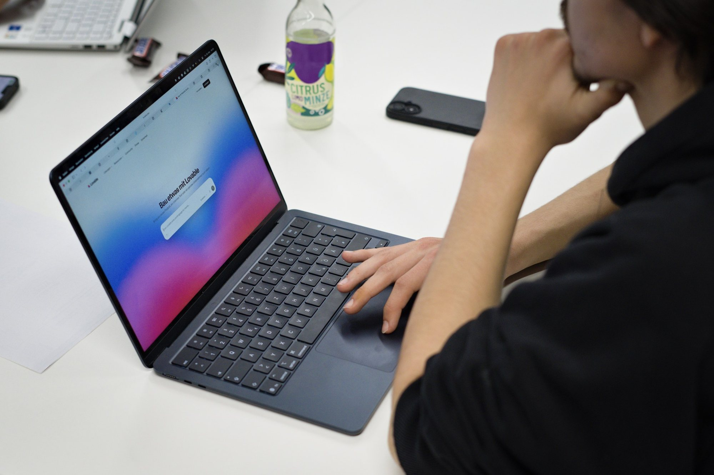
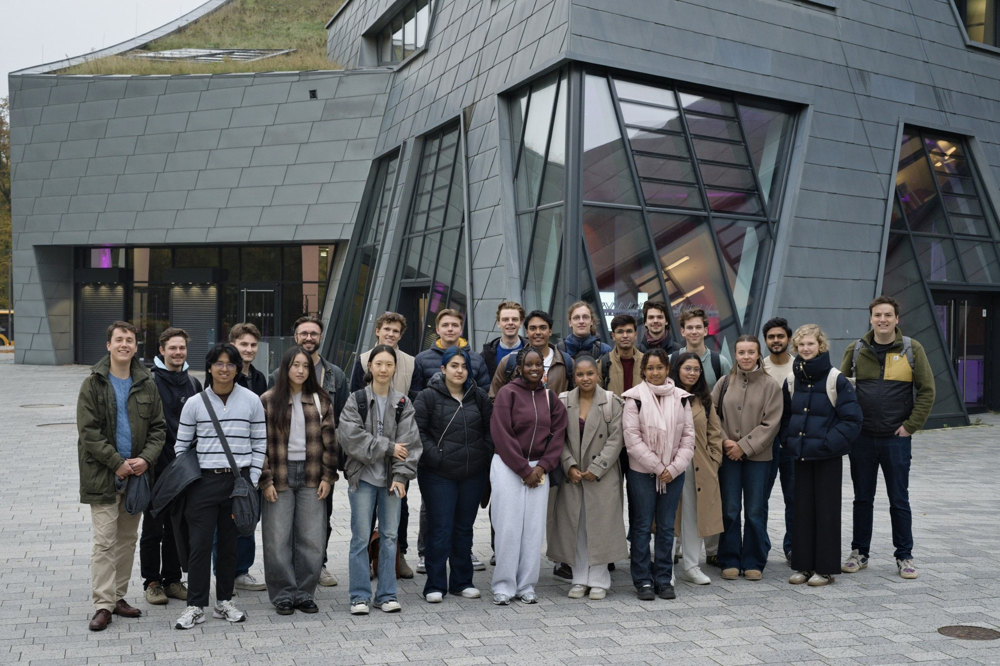

# AI-Campus Day: In 25 Minuten von der Idee zum Prototyp

Am 30. Oktober fand der erste AI-Campus Day an der Leuphana statt. Zusammen mit der Leuphana Universität Lüneburg, der TU Hamburg und dem Leuphana StartUp Lab haben wir Studierende beider Unis für einen Nachmittag rund um KI und Gründen zusammengebracht. Die Idee: KI als Werkzeug fürs Gründen ausprobieren und sich dabei kennenlernen.

#### Creative Space und Impuls

Los ging es im Creative Space for Human and Artificial Intelligence. Dort gab es einen Einblick in kreative Technologien, Robotik und generative Tools.

Danach kam der Workshop des Leuphana StartUp Labs zur Frage: Wie verändert KI das Gründen? Digitale Produkte lassen sich heute viel schneller bauen. Umso wichtiger werden eine klare Zielgruppe, ein echtes Problem und ein tragfähiges Geschäftsmodell. Themen waren unter anderem Lean Startup, Vertical Innovation und KI-gestützte Produktentwicklung.

#### Von der Idee zum Prototyp

Dann wurde es praktisch. Acht gemischte Teams hatten rund 25 Minuten Zeit, um mit Vibe Coding und der Plattform Lovable einen klickbaren Web-Prototyp zu bauen. Herausgekommen sind zum Beispiel eine digitale Zeitbank, neue Weckformate, ein Tool für kuratierte Social-Media-Beiträge, eine App für eine bessere Körperhaltung, Ideen gegen Einsamkeit und Winterdepression sowie digitale Helfer fürs Fotosortieren und Einkaufen.

#### Pizza und neue Kontakte

Zum Schluss gab es Pizza, Getränke und viel Zeit zum Austausch zwischen Studierenden von Leuphana und TUHH.

Danke an alle, die dabei waren, an Stephan Scheuner für die Leitung und an alle Partner, die den Tag möglich gemacht haben. Wir freuen uns aufs nächste Mal!

Du willst bei den nächsten Events dabei sein? Dann [werde Teil von IGNITE](/mitmachen)!

**CONNECT. INSPIRE. IGNITE. 🔥**
