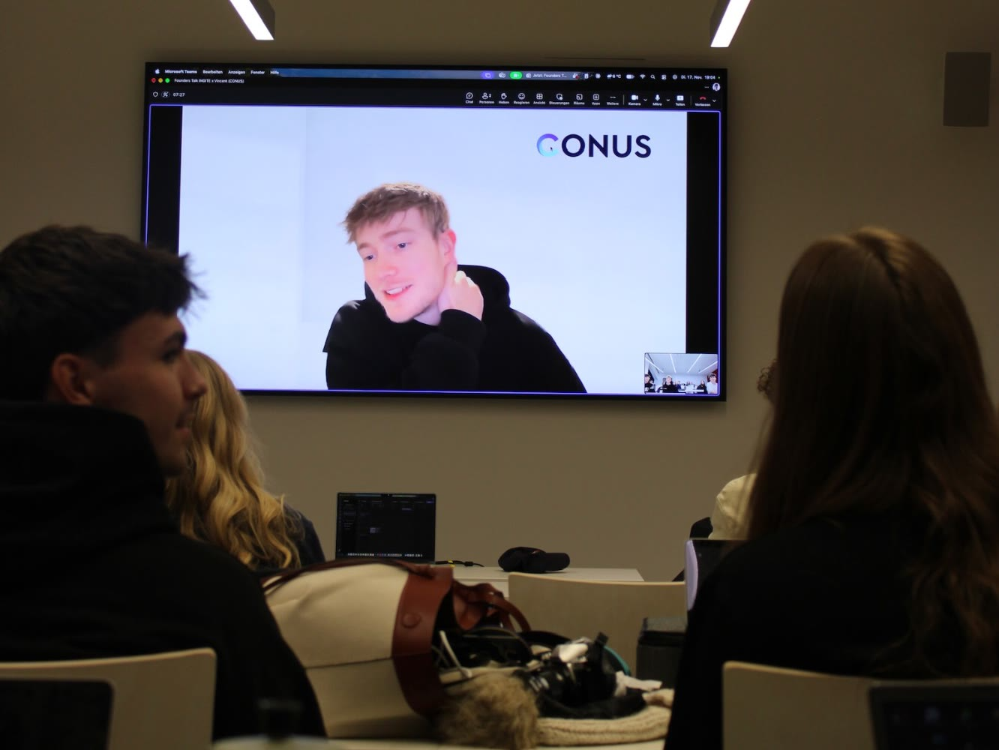

# Founders Talk: Von der Leuphana zu Y Combinator

2025 wurden in San Francisco rund 136 Milliarden US-Dollar Venture Capital in Startups investiert, während es in Hamburg umgerechnet gerade einmal 199 Millionen waren.

Das war nur einer von vielen Reality Checks, die wir am 17. November mitnehmen durften, als wir [Vincent Paffrath](https://www.linkedin.com/in/vincent-paffrath/), Mitgründer und CEO von [CONUS](https://www.linkedin.com/company/conus-med/), bei IGNITE begrüßen durften.

CONUS entwickelt eine KI-Wissensplattform für die Chirurgie, die Medizinproduktehersteller mit Krankenhäusern verbindet und medizinisches Produkt- und OP-Wissen zentral zugänglich macht.

#### Von der ersten Idee zu Y Combinator

Vincent hat selbst an der [Leuphana Universität Lüneburg](https://www.linkedin.com/company/universitat-luneburg/) studiert und uns auf seine Gründungsreise mitgenommen: von der ersten Idee über die Herausforderung, ein Tech-Produkt ohne eigenes Entwicklerteam aufzubauen, bis hin zur Aufnahme bei [Y Combinator](https://www.linkedin.com/company/y-combinator/).

Besonders spannend: Einer seiner Mitgründer hat sich das Programmieren selbst beigebracht. Und aus einem ursprünglich unverbindlichen Gespräch mit einem Y-Combinator-Partner wurde schließlich die Bewerbung und Aufnahme in das Programm.

#### Harte Arbeit und Durchhaltevermögen

Vor allem hat Vincent uns gezeigt, wie viel harte Arbeit und Durchhaltevermögen hinter dem Aufbau eines Startups stecken. Über ein Jahr lang hat er parallel zu Studium und Promotion jeden einzelnen Tag an CONUS gearbeitet. Dabei war ihm die Begeisterung für das, was sie als Team aufbauen, sofort anzumerken.

Auch bei seiner Schätzfrage, wie viel Venture Capital in Hamburg, Berlin und San Francisco in Startups fließt, lagen wir alle ziemlich daneben. Die Unterschiede sind gewaltig.

Anschließend konnten wir ihm unsere Fragen zu Seed-Runden, Unternehmensbewertungen und den ersten Jahren nach der Gründung stellen.

#### Sei brutal ehrlich zu dir selbst

Eine seiner wichtigsten Botschaften: Sei brutal ehrlich zu dir selbst. Denn nur wer seine Probleme ehrlich erkennt, kann sie auch lösen.

Vielen Dank, Vincent, dass du dir trotz deines vollen Terminkalenders die Zeit genommen und deine Erfahrungen so offen mit uns geteilt hast!

Wir wünschen dir und dem gesamten CONUS-Team weiterhin viel Erfolg und freuen uns schon auf ein Update! 🚀

Du willst beim nächsten Founders Talk dabei sein? Dann [werde Teil von IGNITE](/mitmachen)!
