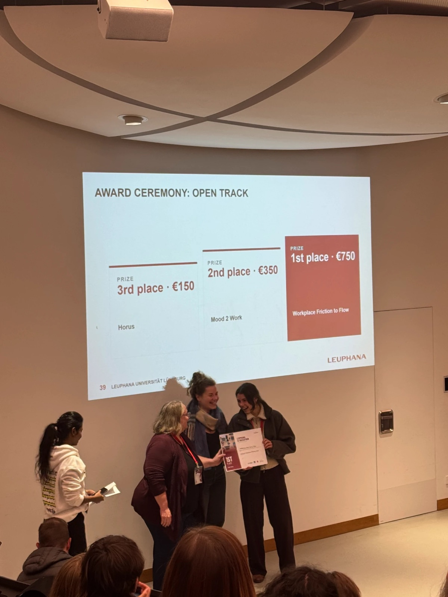
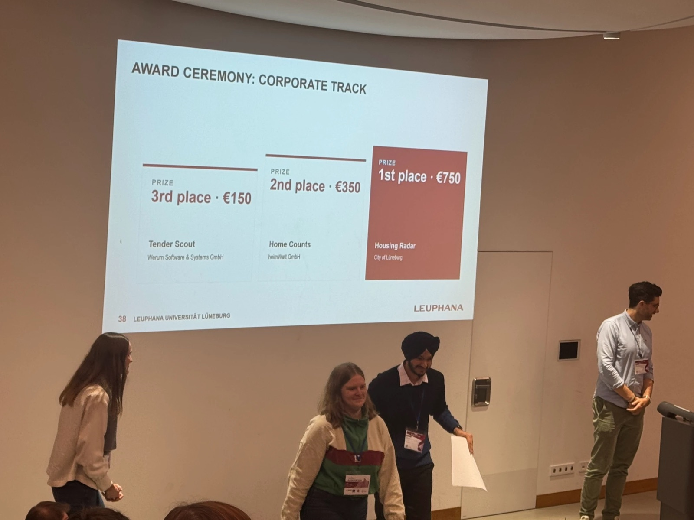

# Leuphana AI Hackathon: 48 Stunden vom Problem zum KI-Prototyp

Am 5. und 6. November wurde das Bibliotheksfoyer der Leuphana zur Werkstatt. Beim Leuphana AI Hackathon hatten Teams zwei Tage Zeit, um aus einer Idee einen funktionierenden KI-Prototypen zu bauen. Die Teilnahme war kostenlos, und es ging nicht ums Reden über KI, sondern ums Bauen damit. Als IGNITE haben wir den Hackathon gemeinsam mit dem [Leuphana StartUp Lab](https://www.leuphana.de/kooperationen/leuphana-entrepreneurship-center/gruendungsunterstuetzung/leuphana-ai-hackathon.html) und dem Leuphana AI Campus organisiert.

#### Zwei Tracks, ein Ziel

Der Hackathon lief in zwei parallelen Tracks:

- **Open Track:** Wer eine eigene Idee hatte, hat sie am Donnerstagmorgen gepitcht. Danach haben sich gemischte Teams aus Tech, Business und Kreativen gebildet.
- **Corporate Track:** Hier haben die Teams an echten Fragestellungen von Partnern gearbeitet, mit einer Ansprechperson aus dem Unternehmen, die die ganze Zeit als Sparringspartner dabei war.

In beiden Tracks galt dasselbe Prinzip: Mit Vibe Coding, No-Code- und KI-Tools entsteht in kurzer Zeit ein Prototyp, den man wirklich ausprobieren kann. Tiefe Programmierkenntnisse brauchte dafür niemand. Mentorinnen und Mentoren aus Tech und Gründungsszene haben bei der Umsetzung und beim Geschäftsmodell geholfen.

#### Sprint, Pizza, Sprint

Der Donnerstag startete mit Frühstück, Opening und Teambuilding. Danach ging es in Sprints: erst recherchieren und Ideen schärfen, dann bauen und testen. Zwischendurch gab es Mittagessen, Kaffee und abends Pizza, bevor der erste Tag erst um 22 Uhr endete.

Am Freitag stand alles im Zeichen des Finales: Pitchtraining, ein letzter Sprint und um 14 Uhr das Ende der Bauphase. Am Nachmittag haben alle Teams ihre Prototypen vor der Jury aus Wissenschaft, Wirtschaft und Investment-Szene gepitcht. Danach folgte die Preisverleihung.

#### 🏆 Open Track

1. **Workplace Friction to Flow (750 €):** eine HR-App, in der Mitarbeitende Probleme melden und andere zustimmen können
2. **Mood 2 Work (350 €):** eine Lernplan-App, die sich an deine Energie anpasst
3. **Horus (150 €):** schützt private Daten, bevor sie in die KI gehen, lokal und Open Source

#### 🏢 Corporate Track

1. **Housing Radar (750 €):** Heatmap-Dashboard zum Wohnraum in Lüneburg, entwickelt mit der Stadt
2. **Home Counts (350 €):** Chatbot Theo checkt deine Immobilie und vermittelt Handwerker und Förderungen, Challenge von heimWatt GmbH
3. **Tender Scout (150 €):** findet passende Aufträge für Unternehmen, Challenge von Werum Software & Systems GmbH

#### ⭐ Sonderpreis von Impossible Founders

Den IF Venture Prize hat **Vora Card** gewonnen: eine Karte, mit der Patienteninfos wie Vollmachten leichter weitergegeben werden.

#### Danke!

Herzlichen Glückwunsch an alle Gewinnerteams! 🎉 Und danke an alle, die mitgemacht haben: In zwei Tagen sind Prototypen entstanden, die man sonst über Wochen baut. Danke auch an die Jury, die Mentorinnen und Mentoren, die Partner mit ihren Challenges und an das Leuphana StartUp Lab und den Leuphana AI Campus für die Zusammenarbeit.

Du willst beim nächsten Mal dabei sein? Folge uns auf [Instagram](https://www.instagram.com/ignite.lueneburg), damit du nichts verpasst, oder [werde Teil von IGNITE](/mitmachen)!

**CONNECT. INSPIRE. IGNITE. 🔥**
