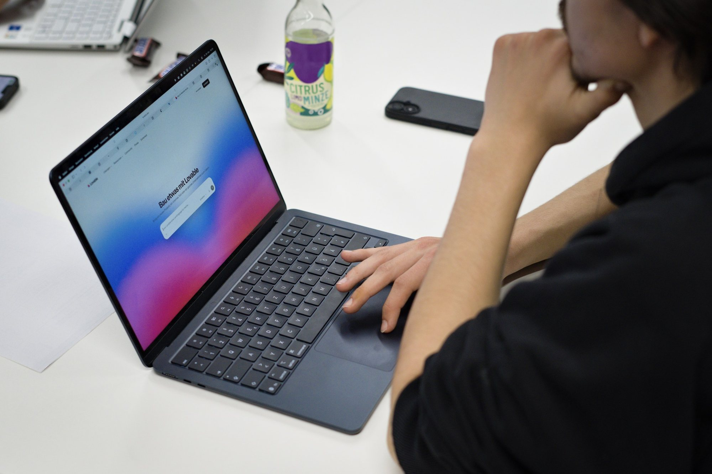
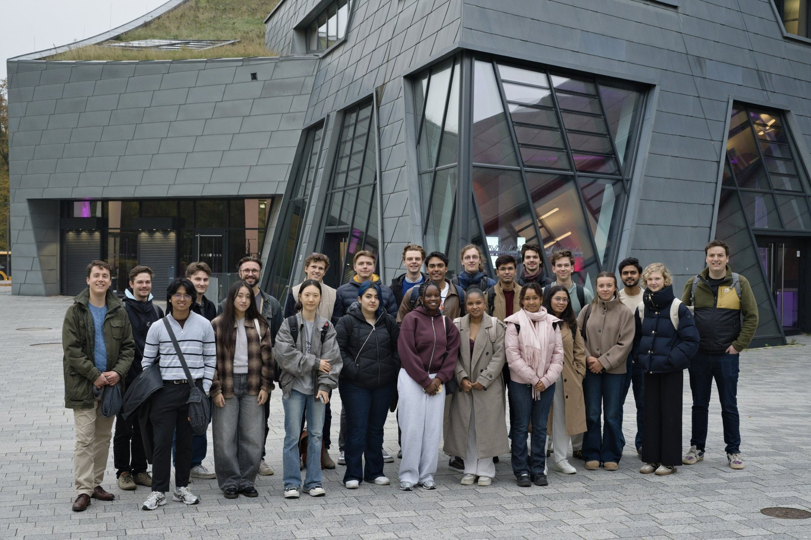

# AI Campus Day: From idea to prototype in 25 minutes

On 30 October, the first AI Campus Day took place at Leuphana. Together with Leuphana University Lüneburg, TU Hamburg and the Leuphana StartUp Lab, we brought students from both universities together for an afternoon on AI and founding. The idea: try out AI as a tool for founding and get to know each other along the way.

#### Creative Space and keynote

We started in the Creative Space for Human and Artificial Intelligence, with a look at creative technologies, robotics and generative tools.

Next came the Leuphana StartUp Lab workshop on one question: how does AI change founding? Digital products can now be built much faster. That makes a clear target group, a real problem and a solid business model even more important. Topics included Lean Startup, Vertical Innovation and AI-supported product development.

#### From idea to prototype

Then it got practical. Eight mixed teams had about 25 minutes to build a clickable web prototype with vibe coding and the Lovable platform. The results included a digital time bank, new wake-up formats, a tool for curated social media posts, an app for better posture, ideas against loneliness and winter blues, and digital helpers for sorting photos and shopping.

#### Pizza and new contacts

We wrapped up with pizza, drinks and plenty of time for students from Leuphana and TUHH to connect.

Thanks to everyone who came, to Stephan Scheuner for leading the day and to all partners who made it possible. See you next time!

Want to join our next events? Then [become part of IGNITE](/en/join)!

**CONNECT. INSPIRE. IGNITE. 🔥**
