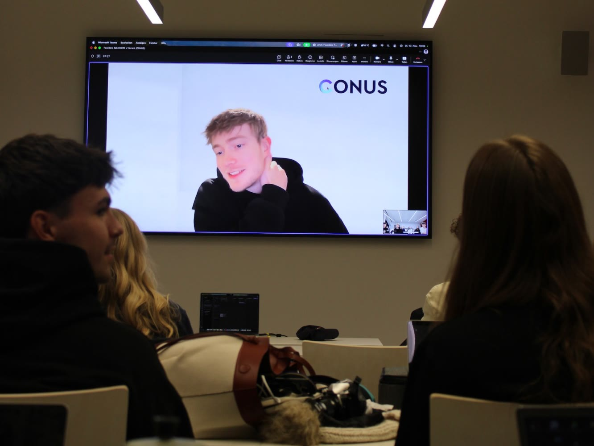

# Founders Talk: From Leuphana to Y Combinator

In 2025, around 136 billion US dollars of venture capital were invested in startups in San Francisco, while Hamburg saw the equivalent of just 199 million.

That was only one of many reality checks we took away on 17 November, when we welcomed [Vincent Paffrath](https://www.linkedin.com/in/vincent-paffrath/), co-founder and CEO of [CONUS](https://www.linkedin.com/company/conus-med/), at IGNITE.

CONUS is building an AI knowledge platform for surgery that connects medical device manufacturers with hospitals and makes medical product and surgical knowledge available in one place.

#### From the first idea to Y Combinator

Vincent studied at [Leuphana University Lüneburg](https://www.linkedin.com/company/universitat-luneburg/) himself and took us along on his founding journey: from the first idea, through the challenge of building a tech product without a development team of their own, to being accepted by [Y Combinator](https://www.linkedin.com/company/y-combinator/).

One part we found especially exciting: one of his co-founders is a self-taught programmer. And what started as an informal chat with a Y Combinator partner eventually led to the application and a place in the program.

#### Hard work and perseverance

Above all, Vincent showed us how much hard work and perseverance go into building a startup. For more than a year, he worked on CONUS every single day alongside his studies and his doctorate. His enthusiasm for what they are building as a team was obvious right away.

He also asked us to guess how much venture capital goes into startups in Hamburg, Berlin and San Francisco, and we were all quite far off. The differences are enormous.

Afterwards, we had the chance to ask him our questions about seed rounds, company valuations and the first years after founding.

#### Be brutally honest with yourself

One of his most important messages: be brutally honest with yourself. Only those who honestly recognise their problems can solve them.

Thank you, Vincent, for taking the time despite your full schedule and for sharing your experiences so openly with us!

We wish you and the whole CONUS team continued success and look forward to an update! 🚀

Want to join the next Founders Talk? Then [become part of IGNITE](/en/join)!
