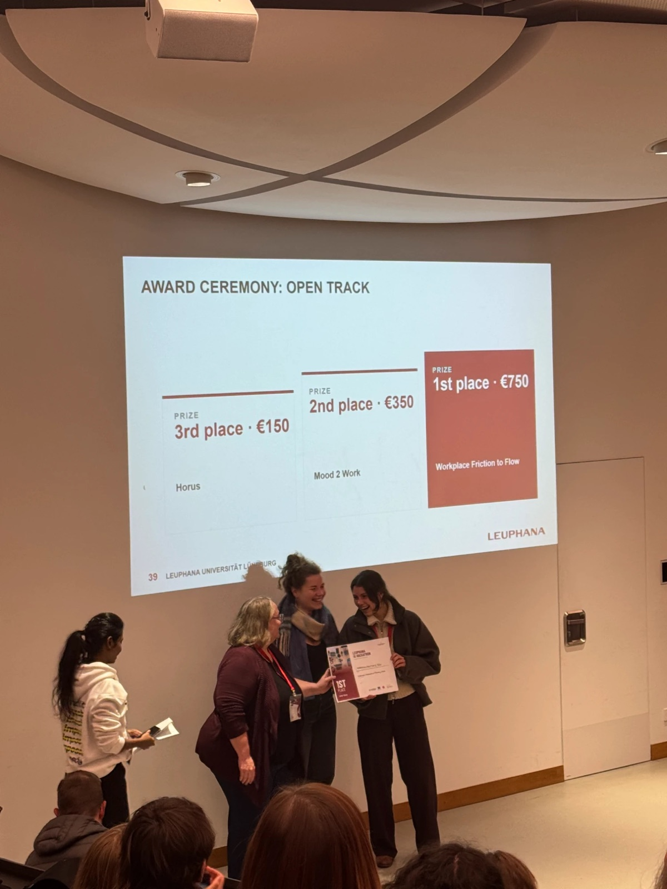
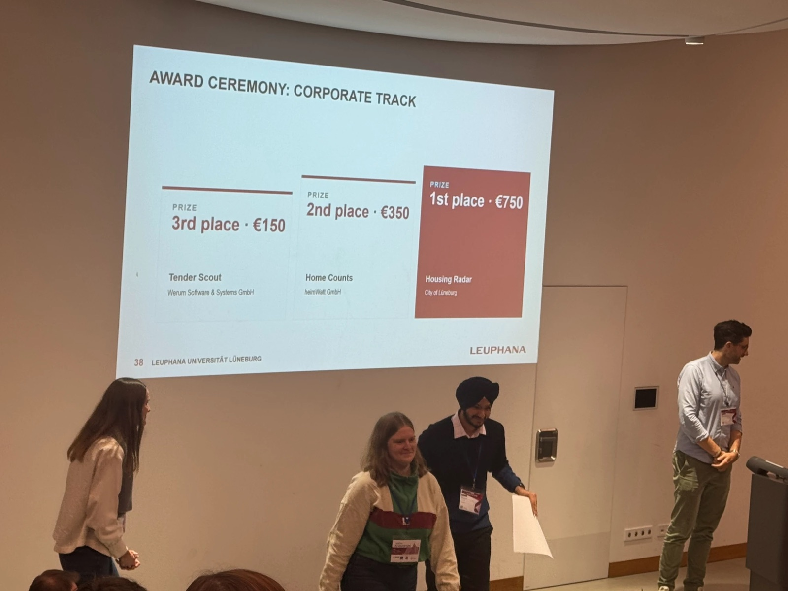

# Leuphana AI Hackathon: 48 hours from problem to AI prototype

On 5 and 6 November, the Leuphana library foyer turned into a workshop. At the Leuphana AI Hackathon, teams had two days to turn an idea into a working AI prototype. Taking part was free, and the point was not to talk about AI but to build with it. As IGNITE, we organised the hackathon together with the [Leuphana StartUp Lab](https://www.leuphana.de/kooperationen/leuphana-entrepreneurship-center/gruendungsunterstuetzung/leuphana-ai-hackathon.html) and the Leuphana AI Campus.

#### Two tracks, one goal

The hackathon ran in two parallel tracks:

- **Open Track:** Anyone with their own idea pitched it on Thursday morning. Mixed teams of tech, business and creative people then formed around the ideas.
- **Corporate Track:** Here, teams worked on real questions from partners, with a company contact on hand as a sparring partner the whole time.

Both tracks followed the same principle: with vibe coding, no-code and AI tools, you can build a prototype people can actually try in a short time. Nobody needed deep programming skills for that. Mentors from tech and the startup scene helped with the build and the business model.

#### Sprint, pizza, sprint

Thursday started with breakfast, the opening and team building. Then came the sprints: first research and sharpening ideas, then building and testing. In between there was lunch, coffee and pizza in the evening, and day one only ended at 10 pm.

Friday was all about the finale: pitch training, one last sprint and the end of the build phase at 2 pm. In the afternoon, every team pitched its prototype to the jury from academia, business and the investment scene. The award ceremony followed.

#### 🏆 Open Track

1. **Workplace Friction to Flow (€750):** an HR app where employees report problems and others can upvote them
2. **Mood 2 Work (€350):** a study planner app that adapts to your energy
3. **Horus (€150):** protects private data before it reaches the AI, locally and open source

#### 🏢 Corporate Track

1. **Housing Radar (€750):** a heatmap dashboard on housing in Lüneburg, built with the city
2. **Home Counts (€350):** the chatbot Theo checks your property and connects you with tradespeople and funding, a challenge by heimWatt GmbH
3. **Tender Scout (€150):** finds matching tenders for companies, a challenge by Werum Software & Systems GmbH

#### ⭐ Special prize by Impossible Founders

The IF Venture Prize went to **Vora Card**: a card that makes it easier to share patient information such as powers of attorney.

#### Thank you!

Congratulations to all winning teams! 🎉 And thanks to everyone who took part: in two days, you built prototypes that would usually take weeks. Thanks also to the jury, the mentors, the partners and their challenges, and to the Leuphana StartUp Lab and the Leuphana AI Campus for working with us.

Want to join next time? Follow us on [Instagram](https://www.instagram.com/ignite.lueneburg) so you don't miss anything, or [become part of IGNITE](/en/join)!

**CONNECT. INSPIRE. IGNITE. 🔥**
