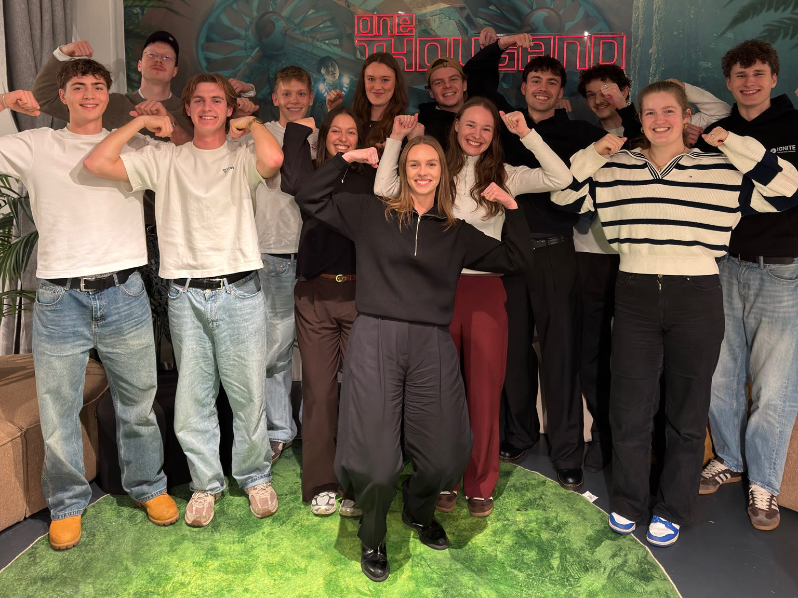

# Team trip to Berlin: Just do it!

A shared döner right after we arrived, conversations about AI and an evening trip to the Brandenburg Gate. That was our trip to Berlin.

#### Insights into the startup scene

We gained exciting insights into the startup scene. At [One Thousand](https://www.linkedin.com/company/one-thousand-ai/) we had the chance to talk to founder [Tim R. Schleicher](https://www.linkedin.com/in/tim-schleicher/).

Next we visited [encentive](https://www.linkedin.com/company/encentive/) and the [Merantix AI Campus](https://www.linkedin.com/in/merantix-ai-campus-4b5755450/), where [Moritz Zimmermann](https://www.linkedin.com/in/mo-zimmermann/) gave us a tour and we talked to representatives of [Briink](https://www.linkedin.com/company/briinkedin/) and [Vara](https://www.linkedin.com/company/vara-ai/).

#### What we took away

One thing above all: **Just do it!**

Not every idea has to be perfect from the start. Get going, try things out and learn from mistakes. We also found plenty of inspiration for our own ideas and projects.

#### More than startup visits

Of course, the trip was about more than visiting startups. Shared activities and game nights left plenty of room for good company and a new team spirit.

With new ideas, great memories and many shared moments, we headed back to Lüneburg.

Berlin, thank you for the time! ❤️

Want to come along on the next trip? Then [become part of IGNITE](/en/join)!
